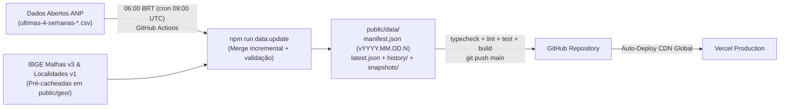

# PreçoBrasil — Observatório Nacional de Preços por Estado e Município

[](./LICENSE)
[](https://react.dev/)
[](https://www.typescriptlang.org/)
[](https://vite.dev/)
[](https://vercel.com/)
[](./docs/DATA-SOURCES-ARCHITECTURE.md)

Plataforma web **mobile-first** com padrão visual corporativo para acompanhar a **evolução diária dos preços médios no Brasil**, com mapa coroplético interativo por **Estado (27 UFs)** e **zoom desmembrando todos os Municípios (5.571 geometrias IBGE)**, histórico diário real, busca exata e leitor por **código de barras (ANP, NCM, EAN-13 / GTIN)** e atualização automática diária às **06:00 BRT** via JSON versionado para deploy contínuo na **Vercel**.

---

## Principais Recursos

- **Mapa Coroplético em 2 Níveis (`d3-geo` + IBGE Malhas v3)**:
  - Visão inicial do **Brasil** dividido nos 27 estados, colorido por faixa de preço do item selecionado.
  - Ao tocar/clicar em um estado, o mapa aplica zoom desmembrando os **municípios** daquela UF e exibe os preços médios municipais, faixa mínimo–máximo e quantidade de coletas oficiais.
- **Evolução Diária com Série Histórica (`Recharts`)**:
  - Acompanhamento dia a dia com alternância entre **Média Móvel de 7 dias** (`avg7d`) e **Coleta Exata do Dia** (`avg`), filtros de horizonte (`7D`, `30D`, `90D`, `Tudo`), linha de referência nacional e tabela resumida dos últimos pregões.
- **Busca Exata & Leitor de Código de Barras (Câmera + GTIN/ANP/NCM)**:
  - Busca sem ambiguidade por código ANP (`320102001`), código fiscal NCM (`27101259`), GTIN/EAN ou descrição.
  - Validação matemática de dígito verificador GS1 (`EAN-8`, `EAN-13`, `GTIN-14`).
  - Consulta ao vivo na API v2 do **Open Food Facts Brasil** para códigos de barras de varejo ainda fora da cesta principal.
  - Leitor pela câmera do celular com `html5-qrcode` carregado sob demanda.
- **Padrão Corporativo Mobile-First & PWA**:
  - Navegação inferior dedicada no celular (`Mapa`, `Itens`, `Histórico`, `Código`), drawer/bottom-sheet de detalhes por município, tema **Claro/Escuro**, `tabular-nums` em todos os valores financeiros e suporte a instalação como PWA (`manifest.webmanifest`).
- **Paridade Etanol vs Gasolina**:
  - Cálculo automático da relação Etanol/Gasolina na faixa de indicadores (sinalizando competitividade no limite clássico de `≤ 70%`).

---

## Cesta Inicial Monitorada (Combustíveis & Energia — ANP)

| Ordem | Item | Unidade | Código ANP | NCM | Fonte Oficial |
| :---: | :--- | :---: | :---: | :---: | :--- |
| 1 | **Gasolina Comum** | `R$/L` | `320102001` | `27101259` | ANP — LPC |
| 2 | **Etanol Hidratado** | `R$/L` | `810101001` | `22071090` | ANP — LPC |
| 3 | **Óleo Diesel S10** | `R$/L` | `820101034` | `27101921` | ANP — LPC |
| 4 | **Óleo Diesel Comum** | `R$/L` | `820101012` | `27101921` | ANP — LPC |
| 5 | **Gasolina Aditivada** | `R$/L` | `320102002` | `27101259` | ANP — LPC |
| 6 | **Gás de Cozinha (GLP 13 kg)** | `R$/13kg` | `210203001` | `27111910` | ANP — GLP |
| 7 | **Gás Natural Veicular (GNV)** | `R$/m³` | `220101005` | `27112100` | ANP — LPC |

*(A série histórica incluída no repositório cobre **102 dias de coletas reais em 2026** com **390.584 registros** distribuídos nas **27 UFs** e **418 municípios** pesquisados pela ANP.)*

---

## Arquitetura de Atualização Diária e Deploy na Vercel

O projeto adota **persistência estática versionada em JSON**: sem custo de banco de dados gerenciado, sem *cold start* e com histórico imutável rastreado pelo próprio Git.



Consulte [docs/DATA-SOURCES-ARCHITECTURE.md](./docs/DATA-SOURCES-ARCHITECTURE.md) para o estudo completo das fontes oficiais no Brasil (ANP, IBGE, SEFAZ NFC-e estaduais, CONAB/DIEESE e bases GTIN).

---

## Como Rodar Localmente

### Pré-requisitos
- **Node.js `>= 20`** e **npm**

### Passo a Passo

```bash
git clone https://github.com/djcristianosgp/preco-brasil.git
cd preco-brasil
npm install
npm run dev
```

Acesse `http://localhost:5173` no navegador (use `npm run dev -- --host` caso queira abrir diretamente pelo celular na mesma rede Wi-Fi).

### Scripts Disponíveis

| Comando | Descrição |
| :--- | :--- |
| `npm run dev` | Inicia o servidor local de desenvolvimento (`Vite`). |
| `npm run data:update` | Baixa as últimas 4 semanas oficiais da ANP e atualiza `public/data/` preservando o histórico antigo. |
| `npm run data:backfill` | Descobre os CSVs mensais de 2026 no portal da ANP e reconstrói a série histórica (use `-- --full-year` para o ano inteiro). |
| `npm run data:geo` | Baixa/regenera as malhas GeoJSON do IBGE (`public/geo/`) com correção de *winding order* para `d3-geo`. |
| `npm run typecheck` | Executa checagem estrita de tipos (`tsc --noEmit`). |
| `npm run lint` | Executa ESLint (incluindo teto de 350 linhas por módulo produtivo e proibição de `console.*` direto). |
| `npm run test` / `npm run test:coverage` | Roda os testes unitários e de integração (`Vitest`) com relatório de cobertura (`>= 80%`). |
| `npm run build` | Gera o bundle de produção em `dist/`. |

---

## Publicação na Vercel & Rotina Diária

1. Importe o repositório `djcristianosgp/preco-brasil` no painel da **Vercel** (`Framework Preset: Vite`, já configurado em [vercel.json](./vercel.json)).
2. No GitHub, certifique-se de que **Actions** esteja habilitado em *Settings → Actions → General* com permissão de leitura e escrita para `GITHUB_TOKEN` (`permissions: contents: write` já declarada em [daily-price-update.yml](./.github/workflows/daily-price-update.yml)).
3. Todos os dias às **06:00 (horário de Brasília)** o workflow executará `npm run data:update`, validará testes e build, e fará commit em `public/data/` caso haja novas coletas da ANP — disparando automaticamente um novo deploy versionado na Vercel. Você também pode disparar manualmente via **Actions → Run workflow** (inclusive com opção `backfill: true`).

---

## Estrutura do Projeto

```text
preco-brasil/
├── .agents/skills/
│   └── atualizar-precos-diarios/   # Skill portátil de IA para rotina de atualização e auditoria de preços
├── .github/workflows/
│   └── daily-price-update.yml      # Automação diária às 06:00 BRT
├── docs/
│   └── DATA-SOURCES-ARCHITECTURE.md
├── public/
│   ├── data/
│   │   ├── catalog.json            # Catálogo de itens e códigos ANP/NCM/EAN
│   │   ├── manifest.json           # Metadados e versão ativa (YYYY.MM.DD.N)
│   │   ├── latest.json             # Médias atuais Brasil, 27 UFs e municípios
│   │   ├── history/by-item/        # Série diária por item (Brasil + UFs)
│   │   ├── history/by-state/       # Série diária municipal por UF (lazy-loaded)
│   │   └── snapshots/              # Histórico de versões publicadas
│   └── geo/
│       ├── brazil-states.json      # Malha IBGE das 27 UFs (winding order corrigido)
│       ├── ibge-municipalities-index.json
│       └── states/{UF}.json        # Malhas municipais dos 27 estados
├── scripts/
│   ├── fetch-ibge-geo.mjs
│   ├── update-prices.mjs
│   └── lib/anp-csv-parser.mjs
└── src/
    ├── components/                 # Mapa, itens, ranking, gráficos Recharts, código de barras e modais
    ├── hooks/                      # Estado de exploração, drilldown e SEO dinâmico
    ├── services/                   # Carregamento em cache + consulta Open Food Facts Brasil
    ├── types/                      # Contratos TypeScript estritos
    └── utils/                      # Formatação BRL, escala coroplética, GTIN Mod-10 e geoWinding
```

---

## Skill de IA Incluída no Repositório

Este repositório acompanha uma **Agent Skill** versionada em [`.agents/skills/atualizar-precos-diarios/SKILL.md`](./.agents/skills/atualizar-precos-diarios/SKILL.md) para que agentes de IA (Antigravity, Claude Code, Codex, etc.) executem com segurança e determinismo a atualização diária dos preços, adição de novos itens ao catálogo, backfill histórico, auditoria das métricas e rollback caso ocorram falhas nas fontes oficiais.

---

## Roadmap Aberto & Contribuições

- [ ] Conectores estaduais de **NFC-e / SEFAZ** (*Menor Preço PR/RS*, *Economiza Alagoas*, *Preço da Hora BA*) para itens de supermercado com GTIN.
- [ ] Inclusão de séries de **Cesta Básica (DIEESE)** e **Hortifrúti Atacado (CONAB/PROHORT)**.
- [ ] Exportação de comparativos e relatórios em CSV/PDF.

Contribuições são bem-vindas via **Issues** e **Pull Requests**:
1. Faça um fork do projeto e crie uma branch descritiva (`feat/novo-conector-sefaz`).
2. Garanta que `npm run typecheck`, `npm run lint`, `npm run test:coverage` e `npm run build` passem sem erros.
3. Abra seu Pull Request explicando o contexto e a fonte oficial dos dados adicionados.

---

## Fontes de Dados & Licença

- **Preços de Combustíveis e GLP**: [Dados Abertos da ANP](https://www.gov.br/anp/pt-br/centrais-de-conteudo/dados-abertos/serie-historica-de-precos-de-combustiveis)
- **Malhas Territoriais e Municípios**: [API de Serviços do IBGE (v1 / v3)](https://servicodados.ibge.gov.br/api/docs)
- **Consulta de Produtos por Código de Barras**: [Open Food Facts Brasil](https://br.openfoodfacts.org/)

Distribuído sob a licença **[MIT](./LICENSE)**.
